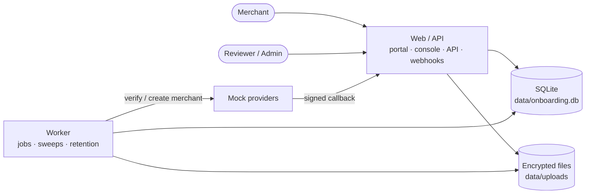
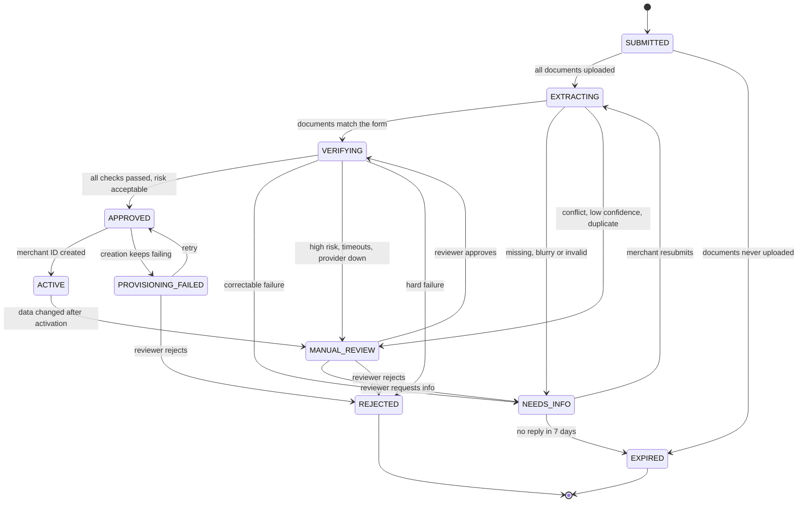
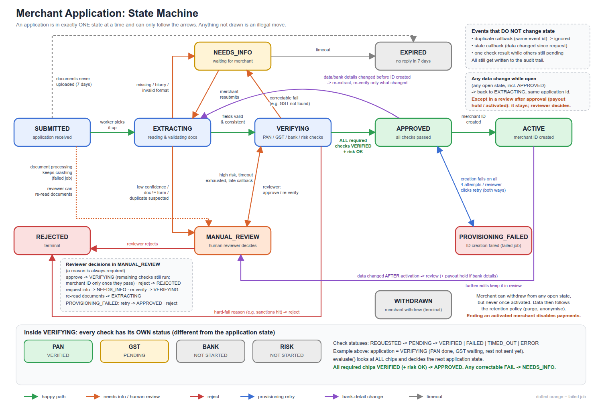
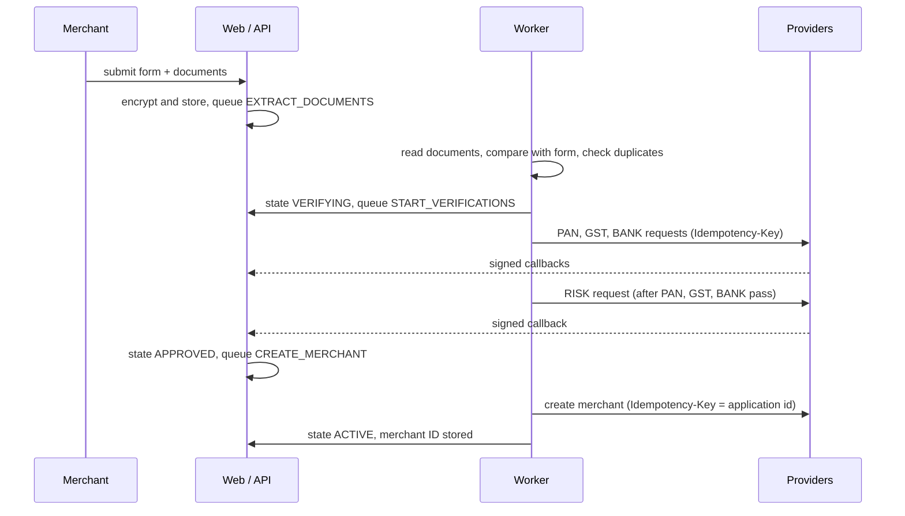

# Architecture

## Overview

The platform runs as three processes that share one SQLite database:

| Process | Started by | Role |
|---|---|---|
| **Web / API** (FastAPI, port 8000) | `run.sh` | Merchant portal, staff console, JSON API, provider webhooks |
| **Worker** | `run.sh` | Background jobs: reading documents, calling providers, creating merchant IDs, timeouts, expiry, data retention |
| **Mock providers** (FastAPI, port 8001) | `run.sh` | Stand-ins for the PAN, GST, bank, risk and merchant-ID services |



The web process never calls a provider and never does slow work. It writes the change and queues a job in the same
transaction; the worker picks the job up. Provider results come back asynchronously as signed webhooks.

## Code layout

```
app/
  main.py            FastAPI app, routers, error pages, security headers
  routes/            portal.py (merchant), console.py (staff), api.py (JSON API), auth_pages.py (sign in / up)
  services.py        create / update / withdraw applications, merchant-facing status
  domain/
    states.py        the states and the allowed transitions
    engine.py        apply_event(): the only code that changes an application's state
    evaluate.py      decides the next state from a snapshot of the application
    checks.py        what each provider check needs, and its input hash
    rules.py         loads rules.yaml
  extraction/        reading documents: PDF text, OCR, photo orientation, blur check, field validation
  worker.py          job loop, leases, retries, failed jobs, sweeps
  webhooks.py        provider callbacks: signature, de-duplication, stale / late handling
  providers.py       HTTP client for the providers
  duplicates.py      duplicate-application detection
  retention.py       deletion and anonymisation of old data
  auth.py, web.py    accounts, sessions, CSRF, roles
  security.py, filecrypt.py   field encryption, file encryption, masking, signatures
  models.py, db.py   database tables and connection
  templates/, static/         server-rendered pages, CSS, a small JavaScript file
mock_providers/main.py         the mock services
scripts/manage_users.py        account administration
rules.yaml                     workflow rules (no code change needed)
```

## Application lifecycle

An application is in exactly one state. Only the transitions below are allowed; `engine.apply_event()` enforces them.



Not drawn, to keep the diagram readable:

- Any open state except ACTIVE can go to **WITHDRAWN** (merchant withdraws).
- Any open state except ACTIVE goes back to **EXTRACTING** when the merchant changes their data.
- **SUBMITTED** can go to **MANUAL_REVIEW** if reading the documents keeps crashing.

REJECTED, EXPIRED and WITHDRAWN are final.

The full diagram, with every transition and the events that do not change state:
[state_diagram.png](state_diagram.png)



## End-to-end flow



The merchant's page refreshes its status every 3 seconds, so they see each step as it happens.

## Document reading

Every required document must be attached: the portal form refuses to submit without them. An API client that creates
first and uploads later gets an application that waits in SUBMITTED until the last document arrives.

| Input | How it is read | Confidence |
|---|---|---|
| PDF with text | Text taken directly (pdfplumber) | 0.95 |
| Photo or scan | Tesseract OCR, run locally | From OCR word confidence |

Photos are made readable first: the phone's rotation tag is applied, sideways or upside-down photos are turned
upright, small tilts are straightened, and small photos are enlarged. Photos under 800 pixels on the long side are
refused at upload, and blurry photos (sharpness below the `blur_laplacian_min` rule) go back to the merchant.

Fields are found two ways:

- **Identifiers** (PAN, GSTIN, IFSC) by their format, then compared exactly with the form.
- **Names and account numbers** by their label ("Name", "A/c No.", "For …" on a cheque), then compared with the
  form using fuzzy matching: 90 or above passes, 75 to 89 goes to review, below 75 is a conflict.

| Result | Next state |
|---|---|
| Everything matches | VERIFYING |
| Missing document, blurry photo, invalid format | NEEDS_INFO (merchant fixes it) |
| Name conflict, low confidence, suspected duplicate | MANUAL_REVIEW (a reviewer decides) |

Documents are never sent to an outside service.

## Verification

Four checks: PAN, GST, BANK and RISK (`required_checks` in `rules.yaml`; sole proprietors skip GST). RISK is sent
only after the identity checks pass.

- **Asynchronous.** A provider accepts a request (HTTP 202) and calls back later on `/webhooks/{provider}`.
- **Signed.** Every callback carries an HMAC-SHA256 signature (`X-Signature`); unsigned or wrongly signed ones are
  refused.
- **Idempotent.** Requests carry an `Idempotency-Key`, so a retry never creates a second check at the provider.

Every callback is stored and classified:

| Outcome | Meaning |
|---|---|
| Applied | Answer used |
| Duplicate | Same event received again; ignored |
| Stale | Answer for data the merchant has since changed; ignored |
| Late | Arrived after its deadline; sent to review instead of being used |
| Unknown | No matching request; ignored |

Failures follow `reason_actions` in `rules.yaml`: a correctable failure (e.g. `GST_NOT_FOUND`) goes to NEEDS_INFO,
`GST_CANCELLED` to review, and `SANCTIONS_HIT` or `PAN_DECEASED` to REJECTED. A check with no answer by its deadline
is asked again, up to the attempt limit, and then goes to review. HIGH risk goes to review.

## Background jobs

Jobs live in the `jobs` table and are written in the same transaction as the change that needs them, so nothing is
queued for a change that was rolled back.

| Job | Does |
|---|---|
| `EXTRACT_DOCUMENTS` | Read and validate documents, check for duplicates |
| `START_VERIFICATIONS` | Send the provider requests |
| `CREATE_MERCHANT` | Create the merchant ID |

- The worker polls every 0.5 s and **leases** each job for 60 s, renewing the lease every 15 s while it works. If a
  worker crashes, the lease runs out and another run picks the job up.
- Errors are retried with exponential backoff (2 s doubling, capped at 60 s).
- A job that fails every attempt becomes a **failed job**: the application moves to a state a person can see
  (MANUAL_REVIEW or PROVISIONING_FAILED) and a review task opens. Admins can retry it from **Failed jobs**.

Every 2 s the worker also marks overdue provider requests as timed out and expires unanswered applications. Every hour
it runs data retention.

## Human review

A review task opens whenever an application needs a person. Priority 1 tasks come first:

| Priority | When |
|---|---|
| 1 | Merchant ID creation failed, document reading kept crashing, late provider failure on a live merchant, live merchant changed their details |
| 2 | Document conflict, suspected duplicate, high risk, failed check, provider error or timeout |

Every decision needs a reason and is written to the audit trail.

- **Approve** accepts the reason for the review and sends the application back to VERIFYING. The remaining checks
  must still pass before a merchant ID is created.
- **Reject**, **Request info**, **Re-verify** and **Re-read documents** do what they say.

## Changes and duplicates

- **Versions.** When a merchant edits an application, its ID stays the same and a new data version is stored. Each
  check records a hash of the inputs it used, so only checks whose inputs changed are sent again.
- **After activation.** A change to a live merchant opens a review; a bank-detail change also puts payouts on hold.
- **Duplicates.** Each application stores hashed keys for its PAN, GSTIN and bank account. Another application with
  the same key, or a very similar name in the same PIN code, is flagged as a suspected duplicate for review. A
  reviewer can clear it, and it is not flagged again after later edits.

## Data model

| Table | Holds |
|---|---|
| `users`, `sessions` | Accounts and sign-in sessions |
| `applications` | One row per application: state, flags, owner |
| `application_versions` | The encrypted form data of each version |
| `documents` | Uploaded files (pointers to encrypted files on disk) |
| `extracted_fields` | Values read from documents, encrypted, plus a masked copy |
| `verifications` | One row per check attempt: status, deadline, input hash |
| `provider_events` | Every provider callback and how it was classified |
| `jobs` | The job queue |
| `review_tasks` | Work for reviewers |
| `identity_keys` | Hashed identifiers for duplicate detection |
| `merchants` | Created merchant IDs (unique per application) |
| `audit_events` | Append-only history of everything that happened |

SQLite runs in WAL mode, and writes take the lock up front (`BEGIN IMMEDIATE`), so concurrent callbacks never lose an
update.

## Security and privacy

| Area | How |
|---|---|
| Passwords | scrypt with a per-user salt; at least 10 characters with upper case, lower case, a digit and a special character |
| Sessions | HTTP-only, SameSite cookies; 12-hour lifetime, 2 hours idle |
| CSRF | Token on every form, and on API writes made with a sign-in cookie |
| Roles | Merchant (own data only), Reviewer, Admin; checked on every page and endpoint |
| Uploaded files | AES-256-GCM, a new key per file, wrapped by a master key; bound to their application |
| Form data and extracted values | Encrypted field by field (Fernet) |
| Personal data on screen | Masked by default; unmasking and opening documents are recorded in the audit trail |
| Audit trail | Append-only (database triggers block edits and deletes); identifiers are masked before writing |
| Web pages | Content-Security-Policy, no framing, no referrer, no inline scripts |

The encryption keys are created on first run in `data/` and never leave the machine.

## Data retention

The worker runs the policy every hour (`retention` in `rules.yaml`):

| Data | Kept |
|---|---|
| Rejected, expired or withdrawn applications | Documents deleted after 30 days, record anonymised after 90 |
| Merchants | While the account is live, then 7 years, then anonymised |
| Raw provider callbacks | 30 days |
| Audit trail | Kept (holds no raw personal data) |

Merchants read this policy on the public page `/retention-policy`.

## Configuration

| File | Controls |
|---|---|
| `rules.yaml` | Business types, required documents and checks, thresholds, retries, timeouts, reason handling, retention |
| `.env` | Ports, secrets, provider timeout, demo pacing; all options are listed in `.env.example` |

## Design choices

| Choice | Why |
|---|---|
| SQLite | No server to install; WAL mode and immediate locks are enough for one machine |
| Jobs in the database | One store for data and work, so a change and its job are saved together |
| Local OCR (Tesseract) | Documents never leave the machine.|
| Mock providers | The real PAN, GST and bank services need contracts; the mocks use the same asynchronous, signed pattern |
| Server-rendered pages | No build step and no external scripts |
